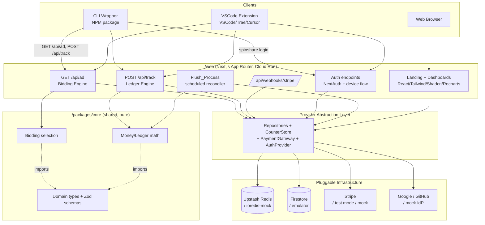
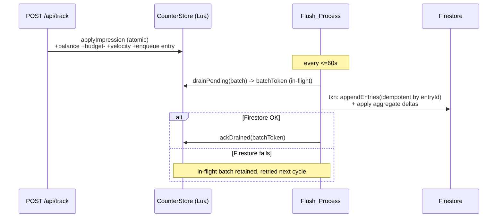
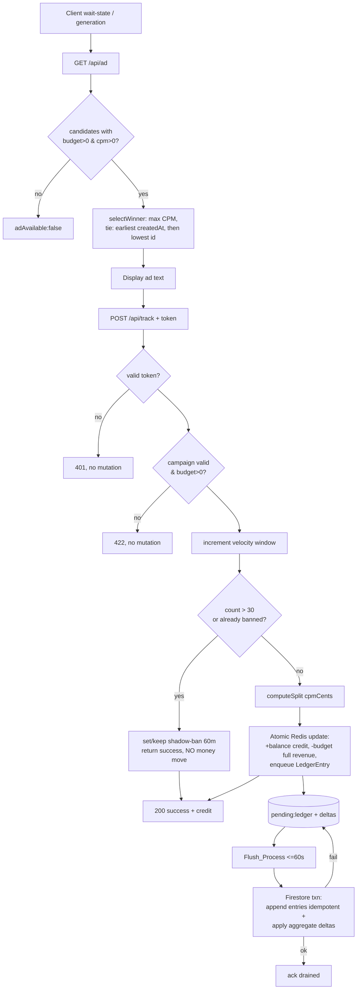

# Design Document

## Overview

SpinShare is a developer-first ad exchange that monetizes the "wait states" of AI coding agents and IDEs. This design describes a monorepo with three deployable artifacts — a Next.js web application (`/web`), an NPM CLI wrapper (`/cli-wrapper`), and a VSCode-compatible extension (`/vscode-extension`) — plus a shared library (`/packages/core`) that holds the money/ledger math and the domain types consumed by both the web runtime and the test suites.

The central design tension is twofold:

1. **Money correctness.** Every impression moves real money. The 60/40 split, penny rounding, and budget conservation must be exact and identical everywhere they are computed. We solve this by extracting all monetary logic into pure functions in `/packages/core` that operate on **integer cents** (never floats), and by reusing those exact functions in the API, the reconciliation process, and the e2e test.

2. **No production credentials yet.** Firebase, Upstash, Stripe, and OAuth credentials are not available. We solve this with a **provider/repository abstraction layer**: the application depends only on interfaces (`UserRepository`, `CampaignRepository`, `LedgerRepository`, `CounterStore`, `PaymentGateway`, `AuthProvider`). A composition root selects implementations from environment configuration. Locally we bind to the Firestore emulator, an in-memory/`ioredis-mock` counter store, and Stripe test-mode/mocked gateway. Swapping to real services is configuration-only — no application code changes.

This document specifies architecture, data models, API contracts, the bidding and ledger engines, Redis→Firestore reconciliation, velocity/shadow-ban anti-fraud, browser-based auth, the client packages, the web UI, the local-development/testability strategy, and an executable set of correctness properties.

### Design Goals and Non-Goals

- **Goal:** Deterministic, exactly-conserving money math reusable across runtime and tests.
- **Goal:** Run the full money path locally with zero external credentials.
- **Goal:** Sub-500ms bidding, instant impression accounting, durable eventual reconciliation.
- **Non-goal:** Multi-currency support (USD only).
- **Non-goal:** Real-time auction across multiple exchanges (single-exchange, highest-CPM-wins).

## Architecture

### System Context



### Architectural Principles

- **Hexagonal / ports-and-adapters.** The web application core logic depends on provider *ports* (interfaces). Adapters for Redis, Firestore, Stripe, and OAuth are wired at a single composition root (`/web/src/server/container.ts`). This is what makes credential-free local development possible.
- **Pure core.** `/packages/core` has no I/O and no environment dependencies. It is the single source of truth for money math and bidding selection, imported by both `/web` and the tests. This guarantees the e2e test and the API compute identical results.
- **Two-tier persistence.** Redis is the hot path (instant, atomic impression accounting and velocity counters). Firestore is the durable system of record, updated by the background Flush_Process. No Firestore write occurs per impression.
- **Idempotency everywhere money moves.** Stripe webhooks and the flush reconciliation are idempotent so retries never double-count.

### Request/Process Flows (high level)

- **Ad request:** Client → `GET /api/ad` → load candidate campaigns → pure `selectWinner` → respond `<500ms`.
- **Impression:** Client → `POST /api/track` → validate token → velocity check → (if not shadow-banned) atomic Redis update via Lua script using pure math → respond.
- **Reconciliation:** Flush_Process (≤60s cadence) → drain Redis deltas + queued ledger entries → write Firestore atomically → mark drained.
- **Funding:** Stripe checkout → webhook (signature verified, idempotent) → increment campaign budget.

## Monorepo Architecture & Layout

### Workspace Tooling

We use **pnpm workspaces** (faster, content-addressed store, strict dependency isolation) with **Turborepo** for task orchestration and caching. npm workspaces are a viable fallback; the layout below is tool-agnostic.

```
spinshare/
├── package.json                 # workspace root, scripts, devDeps
├── pnpm-workspace.yaml          # packages: ["web", "cli-wrapper", "vscode-extension", "packages/*"]
├── turbo.json                   # build/test/lint pipeline + caching
├── tsconfig.base.json           # shared compiler options, path aliases
├── .env.example                 # documents all config keys (local + prod)
├── packages/
│   └── core/                    # @spinshare/core — pure, no I/O
│       ├── src/
│       │   ├── money.ts         # integer-cent math, split, rounding
│       │   ├── bidding.ts       # selectWinner (pure)
│       │   ├── velocity.ts      # window math helpers (pure)
│       │   ├── types.ts         # domain types
│       │   ├── schemas.ts       # Zod schemas (validation, single source)
│       │   └── index.ts
│       └── package.json
├── web/                         # @spinshare/web — Next.js App Router
│   ├── src/
│   │   ├── app/                 # routes (UI + /api/*)
│   │   ├── server/
│   │   │   ├── ports/           # repository + provider interfaces
│   │   │   ├── adapters/        # firestore/, redis/, stripe/, auth/
│   │   │   │   └── memory/      # in-memory + ioredis-mock + mock gateway
│   │   │   ├── container.ts     # composition root (env → adapters)
│   │   │   ├── bidding-service.ts
│   │   │   ├── ledger-service.ts
│   │   │   ├── flush-service.ts
│   │   │   └── auth-service.ts
│   │   └── components/          # Shadcn UI components
│   ├── test/e2e/                # npm run test:e2e
│   └── package.json
├── cli-wrapper/                 # @spinshare/cli — NPM package, `spinshare` bin
│   ├── src/{index.ts,wrap.ts,login.ts,renderer.ts,api-client.ts}
│   └── package.json
└── vscode-extension/            # extension (VSCode/Trae/Cursor)
    ├── src/{extension.ts,ad-controller.ts,auth.ts,api-client.ts}
    └── package.json
```

### Package Relationships

| Package | Depends on | Purpose |
|---|---|---|
| `@spinshare/core` | (nothing runtime) | Pure money math, bidding, types, Zod schemas |
| `@spinshare/web` | `@spinshare/core` | HTTP APIs, UI, provider adapters, flush |
| `@spinshare/cli` | `@spinshare/core` (types only) | Wrap CLI, render ad, report impressions |
| `@spinshare/vscode-extension` | `@spinshare/core` (types only) | Progress-notification ads |

- `@spinshare/core` is built first (Turbo `dependsOn: ["^build"]`). It compiles to ESM + CJS + `.d.ts` so Node CLI, the bundled extension, and Next.js can all consume it.
- Clients share only **types and the API request/response contracts** from core — they never import server adapters.

### Root Scripts

```jsonc
{
  "scripts": {
    "build": "turbo run build",
    "dev": "turbo run dev",
    "test": "turbo run test",
    "test:e2e": "turbo run test:e2e --filter=@spinshare/web",
    "lint": "turbo run lint",
    "emulators": "firebase emulators:start --only firestore"
  }
}
```

## Components and Interfaces

### Provider Abstraction Layer (Ports)

All ports live in `web/src/server/ports`. Services depend on these interfaces only.

```typescript
// CounterStore — the hot path (Redis or in-memory)
interface CounterStore {
  // Atomically applies an impression: credits balance, decrements budget,
  // increments velocity counter, enqueues a ledger entry. Returns the outcome.
  applyImpression(input: ApplyImpressionInput): Promise<ApplyImpressionResult>;
  getBalanceCents(userId: string): Promise<number>;
  getBudgetCents(campaignId: string): Promise<number>;
  // Velocity + shadow-ban
  incrementVelocity(userId: string, windowStartEpochSec: number): Promise<number>;
  isShadowBanned(userId: string): Promise<boolean>;
  setShadowBan(userId: string, ttlSeconds: number): Promise<void>;
  // Reconciliation support
  drainPending(maxEntries: number): Promise<PendingBatch>;
  ackDrained(batchToken: string): Promise<void>;
}

interface CampaignRepository {
  listBiddable(): Promise<Campaign[]>;     // budget>0 AND cpm>0 candidate set
  getById(id: string): Promise<Campaign | null>;
  create(input: NewCampaign): Promise<Campaign>;
  listByAdvertiser(advertiserId: string): Promise<Campaign[]>;
  applyBudgetDeltaCents(id: string, deltaCents: number): Promise<void>; // flush + funding
}

interface UserRepository {
  getById(id: string): Promise<User | null>;
  upsertFromIdentity(identity: ExternalIdentity): Promise<User>;
  applyBalanceDeltaCents(id: string, deltaCents: number): Promise<void>; // flush only
}

interface LedgerRepository {
  appendEntries(entries: LedgerEntry[]): Promise<void>; // idempotent by entryId
}

interface PaymentGateway {
  createCheckoutSession(input: CheckoutInput): Promise<{ url: string; sessionId: string }>;
  verifyAndParseWebhook(rawBody: Buffer, signature: string): StripeEvent; // throws on bad sig
}

interface AuthProvider {
  // device authorization grant + NextAuth-backed browser session
  startDeviceFlow(): Promise<DeviceFlowHandle>;
  pollDeviceToken(deviceCode: string): Promise<DeviceTokenResult>;
  validateToken(token: string): Promise<AuthClaims | null>;
}
```

The **composition root** (`container.ts`) reads `SPINSHARE_ENV` / individual provider flags and returns concrete adapters:

```typescript
export function buildContainer(env = process.env): Container {
  const mode = env.SPINSHARE_MODE ?? "local"; // "local" | "production"
  return {
    counters:   mode === "local" ? new MemoryCounterStore() : new RedisCounterStore(env),
    campaigns:  mode === "local" ? new EmulatorCampaignRepo(env) : new FirestoreCampaignRepo(env),
    users:      mode === "local" ? new EmulatorUserRepo(env) : new FirestoreUserRepo(env),
    ledger:     mode === "local" ? new EmulatorLedgerRepo(env) : new FirestoreLedgerRepo(env),
    payments:   mode === "local" ? new MockPaymentGateway(env) : new StripeGateway(env),
    auth:       mode === "local" ? new MockAuthProvider(env) : new NextAuthDeviceProvider(env),
  };
}
```

Note: `local` can independently point Firestore adapters at the **emulator** (real Firestore client, `FIRESTORE_EMULATOR_HOST`) or at pure in-memory repos. Both are supported; the e2e default uses the emulator for Firestore + `MemoryCounterStore` for Redis to avoid an external Redis dependency.

### Bidding Engine (`bidding-service.ts` + `core/bidding.ts`)

The service loads candidates from `CampaignRepository.listBiddable()` and delegates selection to the pure function. The 500ms budget is enforced with a timeout wrapper; on timeout or empty set it returns "no ad".

```typescript
// @spinshare/core — pure, deterministic
export function selectWinner(candidates: Campaign[]): Campaign | null {
  const eligible = candidates.filter(c => c.budgetCents > 0 && c.cpmCents > 0);
  if (eligible.length === 0) return null;
  return eligible.reduce((best, c) => isBetterBid(c, best) ? c : best);
}

// Strict total order: higher CPM wins; tie → earliest createdAt; tie → lowest id
function isBetterBid(c: Campaign, best: Campaign): boolean {
  if (c.cpmCents !== best.cpmCents) return c.cpmCents > best.cpmCents;
  if (c.createdAtMs !== best.createdAtMs) return c.createdAtMs < best.createdAtMs;
  return c.id < best.id;
}
```

### Ledger Engine (`ledger-service.ts` + `core/money.ts`)

Flow for `POST /api/track`:
1. Validate `Device_Auth_Token` via `AuthProvider.validateToken`; reject 401 if invalid.
2. Load campaign; reject 422 if missing or `budgetCents <= 0` (no mutation).
3. Compute the window start and increment velocity counter.
4. Evaluate shadow-ban (existing ban, or this is the 31st+ impression in the window → ban set with 60-min TTL).
5. Compute the split with pure money functions.
6. If **not** shadow-banned: `CounterStore.applyImpression` performs the atomic Redis update (credit balance, decrement budget, enqueue ledger entry).
7. If shadow-banned: skip crediting/decrementing/ledger-enqueue, but return the **same success shape**.

### Money/Ledger Math (`core/money.ts`)

All money is **integer cents** internally. CPM dollars are converted to cents at the campaign boundary. Per-impression revenue is `cpmCents / 1000`, which is sub-cent, so we keep a higher-precision representation for revenue and round only the developer credit, deriving retention by subtraction to guarantee conservation.

```typescript
// Revenue is in micro-cents (1 cent = 1000 micro-cents) to retain sub-cent precision
// exactly: cpmCents/1000 of a cent => cpmCents micro-cents per impression... see below.

// CPM is dollars-per-1000-impressions. cpmCents = round(cpmDollars * 100).
// per-impression revenue (dollars) = cpmDollars / 1000
// per-impression revenue (cents)   = cpmCents / 1000  (a rational, sub-cent value)
// Represent revenue in MICROCENTS to stay integer and exact:
//   revenueMicrocents = cpmCents * 1000 / 1000 = cpmCents   (1 microcent = 1/1000 cent)
// i.e. per-impression revenue in microcents == cpmCents exactly.

export const MICROCENTS_PER_CENT = 1000;

export interface Split {
  revenueMicrocents: number;   // exact per-impression revenue
  developerCreditCents: number; // rounded to nearest cent
  spinshareRetentionMicrocents: number; // revenue - developerCredit (exact)
}

export function perImpressionRevenueMicrocents(cpmCents: number): number {
  // cpmCents micro-cents-of... revenue(cents) = cpmCents/1000; in microcents = cpmCents
  return cpmCents;
}

export function computeSplit(cpmCents: number): Split {
  const revenueMicrocents = perImpressionRevenueMicrocents(cpmCents);
  // developer credit = 60% of revenue, rounded to nearest CENT (half-up)
  const creditMicrocents = revenueMicrocents * 60; // = revenue * 60/100 in microcents*100; normalize below
  const developerCreditCents = roundHalfUpToCents(revenueMicrocents, 60);
  const developerCreditMicrocents = developerCreditCents * MICROCENTS_PER_CENT;
  const spinshareRetentionMicrocents = revenueMicrocents - developerCreditMicrocents;
  return { revenueMicrocents, developerCreditCents, spinshareRetentionMicrocents };
}

// round(revenueMicrocents * pct/100) to the nearest whole CENT, half-up
function roundHalfUpToCents(revenueMicrocents: number, pct: number): number {
  // value in microcents = revenueMicrocents * pct / 100
  // convert to cents: divide by MICROCENTS_PER_CENT (1000)
  const numerator = revenueMicrocents * pct;          // microcents * 100-scaled
  // cents = numerator / (100 * 1000); round half-up using integer arithmetic
  const denom = 100 * MICROCENTS_PER_CENT;            // 100000
  return Math.floor((numerator + denom / 2) / denom);
}
```

Key invariant enforced by construction: `developerCreditMicrocents + spinshareRetentionMicrocents === revenueMicrocents`, because retention is computed by subtraction. Budget is decremented by the **full** revenue (`revenueMicrocents`), so platform retention is implicitly the part of revenue not credited to the developer. No money is created or lost.

> Implementation note: integer math only. `Math.floor((numerator + denom/2)/denom)` is exact for the value ranges here (CPM ≤ $1000 ⇒ `cpmCents ≤ 100000` ⇒ products stay well within `Number.MAX_SAFE_INTEGER`). A `bigint` path is available if limits widen.

### Redis→Firestore Reconciliation (`flush-service.ts`)

- **Atomic hot-path update.** `CounterStore.applyImpression` is implemented in the Redis adapter as a single **Lua script** (`EVAL`) so balance increment, budget decrement, velocity increment, shadow-ban read, and ledger-entry enqueue happen atomically with no interleaving. The in-memory adapter performs the same steps under a single synchronous critical section.
- **Pending queue.** Each applied impression pushes a durable `LedgerEntry` (with a unique `entryId`) onto a Redis list `pending:ledger` and accumulates per-user/per-campaign deltas in hashes.
- **Cadence.** Flush_Process runs at most every 60 seconds (Cloud Run scheduled invocation / cron). Each cycle calls `drainPending(batchSize)` which atomically moves a batch to an in-flight key and returns a `batchToken`.
- **Idempotent durable write.** Flush writes Firestore in a transaction/batch: append ledger entries (`LedgerRepository.appendEntries` is idempotent keyed by `entryId` via document ID), then apply aggregated balance/budget deltas. Only after the Firestore write succeeds does it call `ackDrained(batchToken)` to remove the in-flight batch.
- **Retry without double-count.** If the Firestore write fails, the batch remains in the in-flight key and is re-merged into pending on the next cycle. Because ledger entries use deterministic document IDs (`entryId`), re-applying a partially-written batch cannot create duplicates; aggregate deltas are recomputed from the (idempotent) ledger entries, not blindly re-added.



### Velocity Rate-Limiting & Shadow-Ban (`core/velocity.ts` + counter store)

- **Window.** Fixed 60-second window keyed by `floor(nowEpochSec / 60)`. The counter key carries a 60s TTL so it expires after the window.
- **Trigger.** On each impression, increment the window counter. If the post-increment count is `> 30` (i.e., the 31st impression and beyond), set the shadow-ban flag with a **60-minute TTL** and treat this impression as banned.
- **Banned behavior.** While banned: serve ads normally (bidding unaffected), `POST /api/track` returns the normal success response, but **no** balance credit, **no** budget decrement, and **no** ledger entry.
- **Restore.** The 60-minute TTL expiring restores the developer automatically; the next impression credits normally.

### Browser-Based Auth (`auth-service.ts` + `AuthProvider`)

- **NextAuth (Auth.js)** handles browser sessions with Google and GitHub providers for the web dashboards.
- **Device Authorization Grant** for clients (CLI/extension), with a **local-callback-server fallback**:
  1. Client calls `POST /api/auth/device/start` → receives `device_code`, `user_code`, `verification_uri`, `interval`, `expires_in=300`.
  2. CLI/extension opens the system browser to `verification_uri?user_code=...`. If the browser cannot launch, it **prints the URL** for manual entry.
  3. User authenticates via Google/GitHub in the browser (NextAuth), approving the device.
  4. Client polls `POST /api/auth/device/token` with `device_code` until it receives a `Device_Auth_Token` or `expired_token`/`access_denied`.
  5. **300s timeout:** if no approval within `expires_in`, the server returns `expired_token` and the client reports failure.
  6. Token stored in OS credential storage (keytar where available, else a `0600` file under the user config dir).
- **Validation.** Protected endpoints (`POST /api/track`) call `AuthProvider.validateToken`; the token encodes/looks up the developer `userId`. No manual API keys at any step.

### CLI Wrapper (`cli-wrapper`)

- `spinshare <target> [...args]` spawns the target as a child process (`child_process.spawn`) with inherited stdin, forwarding developer input.
- **stdout interception.** stdout is piped (not inherited) and processed line/chunk-wise:
  - When a chunk consists of spinner characters from `{ |, /, -, \ }` (optionally with carriage returns/ANSI cursor moves), it is recognized as a **wait state**. Spinner chars are suppressed; the current ad text is rendered on a single updating line using `\r` (carriage return) overwrite.
  - Non-spinner output is forwarded unmodified to the real stdout. stderr is always passed through unmodified.
- **One impression per wait state.** A wait state begins at the first detected spinner frame and ends when non-spinner output resumes. Exactly one `POST /api/track` is sent per wait state (debounced), regardless of how many spinner frames are emitted.
- **Ad lifecycle.** On wait-state start, the wrapper uses a cached/prefetched ad (from `GET /api/ad`); if no ad is available it shows a neutral fallback line (e.g., the original spinner or a quiet placeholder) and records no impression.
- **Exit codes.** The wrapper exits with the child's exit code. If the child is terminated by a signal, the wrapper exits non-zero (`128 + signal`).
- **Auth.** `spinshare login` runs the device flow; protected calls attach the stored token.

### VSCode Extension (`vscode-extension`)

- Listens for AI-generation start/stop signals (command hooks / progress events exposed by the host). Compatible with VSCode, Trae, and Cursor (no APIs beyond the stable `vscode` namespace).
- On generation start: fetch ad (`GET /api/ad`), then `vscode.window.withProgress({ location: ProgressLocation.Notification })` showing the ad text in the bottom-right; report **exactly one** impression to `POST /api/track`.
- On generation complete: resolve the progress promise to dismiss the notification **within 1 second** of completion.
- If unauthenticated, prompt the developer to run the browser-based device flow before showing ads.

### Web UI (`web/src/app`, `web/src/components`)

- **Aesthetic:** dark-mode cyberpunk, neon-green accent `#00FF00` on near-black surfaces, via Tailwind theme tokens + Shadcn UI components. Recharts themed to match.
- **Landing page:** value prop ("Your AI is thinking. You should be earning."), two distinct visible controls — **Developer sign-in** and **Advertiser sign-in** — each initiating the browser auth flow.
- **Developer dashboard:** KPI cards (total earnings), Recharts earnings-over-time line chart, activity ledger table (impressions + credited amounts), with explicit empty and error states; unauthenticated access redirects to auth.
- **Advertiser dashboard:** campaign builder (ad text with live 60-char counter/limit, CPM bid input $0.01–$1000.00), campaign list with remaining budget + CPM, "Add Funds" → Stripe checkout ($1.00–$100,000.00, one-cent precision), with empty/error states.

## Data Models

### Firestore Collections (durable system of record)

All monetary fields are stored as **integer cents** (`*_cents`) to avoid float drift. Timestamps are Firestore `Timestamp`; `createdAtMs` mirrors epoch millis for deterministic tie-breaks.

**`users/{userId}`**

| Field | Type | Notes |
|---|---|---|
| `id` | string | doc id = stable user id |
| `email` | string | from identity provider |
| `provider` | `"google" \| "github"` | identity source |
| `role` | `"developer" \| "advertiser"` | a user may hold both via separate flags if needed |
| `balanceCents` | number (int) | accumulated developer earnings, durable |
| `createdAt` | Timestamp | |
| `updatedAt` | Timestamp | last flush/profile update |

**`campaigns/{campaignId}`**

| Field | Type | Notes |
|---|---|---|
| `id` | string | doc id |
| `advertiserId` | string | owner user id |
| `adText` | string | 1–60 chars |
| `cpmCents` | number (int) | max CPM bid in cents; 1–100000 ($0.01–$1000.00) |
| `budgetCents` | number (int) | remaining budget; starts at 0 |
| `status` | `"active" \| "paused"` | biddable requires active (impl detail; budget>0 & cpm>0 always required) |
| `createdAt` | Timestamp | |
| `createdAtMs` | number (int) | epoch millis, deterministic tie-break |
| `updatedAt` | Timestamp | last flush/funding update |

**`ledgerEntries/{entryId}`** (one durable record per impression)

| Field | Type | Notes |
|---|---|---|
| `entryId` | string | deterministic id (idempotency key) |
| `campaignId` | string | |
| `developerId` | string | |
| `revenueMicrocents` | number (int) | per-impression revenue (exact) |
| `developerCreditCents` | number (int) | credited to developer |
| `spinshareRetentionMicrocents` | number (int) | platform retention (exact) |
| `createdAt` | Timestamp | impression time |
| `flushedAt` | Timestamp | reconciliation time |

**`paymentEvents/{stripeEventId}`** (Stripe webhook idempotency)

| Field | Type | Notes |
|---|---|---|
| `id` | string | Stripe event id = doc id |
| `campaignId` | string | funded campaign |
| `amountCents` | number (int) | confirmed funding |
| `appliedAt` | Timestamp | set once; presence ⇒ already applied |

### Redis Key Schema (hot path)

| Key | Type | Purpose | TTL |
|---|---|---|---|
| `bal:{userId}` | int counter (cents) | pending developer balance delta since last flush | none (flushed) |
| `bud:{campaignId}` | int counter (cents) | pending budget delta (negative) since last flush | none |
| `vel:{userId}:{windowEpochMin}` | int counter | impressions in the fixed 60s window | 60s |
| `ban:{userId}` | flag (`"1"`) | shadow-ban active | 3600s (60 min) |
| `pending:ledger` | list | queued `LedgerEntry` JSON awaiting flush | none |
| `inflight:{batchToken}` | list | batch drained for current flush cycle | safety TTL |
| `bal:dirty` / `bud:dirty` | set | set of userIds/campaignIds with pending deltas | none |

> `windowEpochMin = floor(nowEpochSec / 60)`. The velocity key's 60s TTL realizes the fixed expiring window. Balance/budget deltas are *deltas since last flush*; Firestore holds the authoritative total. After a successful flush + ack, drained deltas are subtracted from the Redis counters (or recomputed from the acked ledger batch) so they are not flushed twice.

## API Contracts

All request/response bodies validated by shared Zod schemas in `@spinshare/core`. JSON unless noted. Money in responses is reported in both cents (authoritative) and a formatted USD string for display.

### `GET /api/ad`

Request: query/header `Authorization: Bearer <token>` optional for ad fetch (impression requires auth at track time).

Response `200` (winner):
```json
{
  "adAvailable": true,
  "campaignId": "cmp_123",
  "adText": "Ship faster with Acme CI",
  "cpmCents": 3000,
  "cpmUsd": "30.00"
}
```
Response `200` (no candidates):
```json
{ "adAvailable": false }
```
- Status codes: `200` always on success path; `500` on internal error. Must respond within **500ms** (server enforces a timeout; on timeout returns `{ "adAvailable": false }`).

### `POST /api/track`

Request:
```json
{ "campaignId": "cmp_123" }
```
Headers: `Authorization: Bearer <Device_Auth_Token>` (required).

Response `200` (recorded, or shadow-banned — identical shape):
```json
{
  "recorded": true,
  "developerCreditCents": 18,
  "developerCreditUsd": "0.18"
}
```
- `401 Unauthorized` — missing/invalid token; no mutation.
- `422 Unprocessable Entity` — campaign missing or `budgetCents <= 0`; body `{ "error": "invalid_or_insufficient_campaign" }`; no mutation.
- `400 Bad Request` — malformed body.
- Shadow-banned developers receive `200` with the success shape; internally no credit/decrement/ledger entry. (To preserve the indistinguishable response, `developerCreditCents` reflects the *computed* credit value as if normal; the difference is purely internal accounting. Implementation MAY return the computed credit to keep responses identical.)

### `POST /api/auth/device/start`

Response `200`:
```json
{
  "deviceCode": "dc_...",
  "userCode": "WXYZ-1234",
  "verificationUri": "https://spinshare-web-vert.vercel.app/activate",
  "verificationUriComplete": "https://spinshare-web-vert.vercel.app/activate?user_code=WXYZ-1234",
  "intervalSec": 5,
  "expiresInSec": 300
}
```

### `POST /api/auth/device/token`

Request: `{ "deviceCode": "dc_..." }`
- `200` `{ "accessToken": "...", "tokenType": "Bearer" }` when approved.
- `400` `{ "error": "authorization_pending" }` while waiting.
- `400` `{ "error": "slow_down" }` if polling too fast.
- `400` `{ "error": "expired_token" }` after 300s.
- `400` `{ "error": "access_denied" }` if user declines.

### `/api/webhooks/stripe`

- `POST` raw body + `Stripe-Signature` header.
- Signature verified via `PaymentGateway.verifyAndParseWebhook`.
- `400` if signature invalid (no mutation).
- On valid `checkout.session.completed`: idempotent by `paymentEvents/{eventId}` — if already applied, return `200` without re-crediting; else increment `campaigns/{id}.budgetCents` by `amountCents` and record the event. Must reflect within **60s**.
- Always `200` to acknowledge a verified event (so Stripe stops retrying), even when it was a duplicate.

### Campaign & Funding (session-authenticated, advertiser)

- `POST /api/campaigns` — body `{ adText, cpmCents }`; validates 1–60 chars, cpm 1–100000; `201` with campaign (budget 0) or `400` with field error.
- `GET /api/campaigns` — advertiser's campaigns.
- `POST /api/funds/checkout` — body `{ campaignId, amountCents }`; validates 100–10000000 cents and one-cent precision; `200` `{ checkoutUrl }` or `400`.

## Money & Impression Flow



## Local Development & Testability Strategy

This is the critical enabler given missing production credentials. The provider abstraction layer makes every external dependency swappable by configuration.

### Configuration switch

`SPINSHARE_MODE=local` (default for dev/test) vs `production`. Individual overrides allowed (e.g., `FIRESTORE_EMULATOR_HOST` to target the emulator while keeping in-memory counters). `.env.example` documents every key:

```
SPINSHARE_MODE=local
FIRESTORE_EMULATOR_HOST=127.0.0.1:8080   # local Firestore via emulator
SPINSHARE_COUNTER=memory                  # "memory" | "rtdb" (Firebase Realtime Database)
FIREBASE_DATABASE_URL=                    # RTDB url; required when SPINSHARE_COUNTER=rtdb
STRIPE_MODE=mock                          # "mock" | "test" | "live"
AUTH_MODE=mock                            # "mock" | "oauth"
```

### Local bindings

| Dependency | Production adapter | Local adapter |
|---|---|---|
| Firestore | `@google-cloud/firestore` | Firestore **emulator** (same client, `FIRESTORE_EMULATOR_HOST`) or in-memory repo |
| Redis | Upstash REST client | `MemoryCounterStore` (default) or `ioredis-mock` |
| Stripe | `stripe` SDK + real signing secret | `MockPaymentGateway` (deterministic events, locally-signed test payloads) or Stripe test mode |
| Auth | NextAuth + Google/GitHub | `MockAuthProvider` issuing deterministic device tokens, mock IdP |

Because all four are behind ports and selected at the composition root, **promoting to real services requires only environment changes** — no code edits.

### `npm run test:e2e` design

The e2e test exercises the full money path in `local` mode and asserts the split, reusing the exact `@spinshare/core` math so the test and the API can never disagree.

1. **Spin up server.** Start the Next.js app in `SPINSHARE_MODE=local` on an ephemeral port. Poll a `/api/health` endpoint until it accepts requests, failing after a **60s** startup timeout (R11.1, R11.8).
2. **Seed.** Create an advertiser + a campaign with a fixed CPM (e.g., `cpmCents = 30000` → $30 CPM) and fund it via a simulated Stripe webhook (mock gateway, signature accepted) so `budgetCents` exceeds one impression's revenue (R11.2).
3. **Authenticate.** Use `MockAuthProvider` to mint a valid `Device_Auth_Token` for a developer (R11.3).
4. **Track.** `POST /api/track` exactly once with the token, below the velocity limit (R11.3).
5. **Force flush.** Invoke the Flush_Process directly (or read Redis counters) to read settled values, then read durable Firestore values via the emulator.
6. **Assert** within one-cent tolerance (R11.4–R11.7):
   - developer balance increased by `developerCreditCents` (= 60% of revenue, rounded);
   - campaign budget decreased by the full per-impression revenue;
   - SpinShare retention == revenue − developer credit (and ≈ 40%);
   - `developerCredit + retention == revenue`.
   - On mismatch, report expected, actual, and difference.

Cleanup tears down the server and clears emulator/in-memory state between runs.

## Correctness Properties

*A property is a characteristic or behavior that should hold true across all valid executions of a system — essentially, a formal statement about what the system should do. Properties serve as the bridge between human-readable specifications and machine-verifiable correctness guarantees.*

These properties were derived from the acceptance criteria via the prework analysis and consolidated to remove redundancy. Each is universally quantified and implemented as a single property-based test running ≥100 iterations.

**Bidding**

### Property 1: Eligibility-gated selection

*For any* list of campaigns, `selectWinner` returns a campaign if and only if at least one campaign has `budgetCents > 0` AND `cpmCents > 0`; when it returns a campaign, that campaign satisfies both eligibility conditions, and when no campaign is eligible it returns "no ad".

**Validates: Requirements 1.1, 1.4**

### Property 2: Highest-CPM winner with deterministic tie-break

*For any* list of campaigns with at least one eligible candidate, the selected winner has a `cpmCents` equal to the maximum `cpmCents` among eligible candidates; among candidates sharing that maximum, the winner is the one with the earliest `createdAtMs`, and the lowest `id` when creation times are equal. The returned `campaignId`, `adText`, and `cpmCents` equal those of the selected winner.

**Validates: Requirements 1.2, 1.3, 1.5, 1.6**

### Property 3: Selection is order-independent (determinism)

*For any* list of campaigns and *for any* permutation of that list, `selectWinner` returns the same winning campaign id.

**Validates: Requirements 1.5**

**Money Split & Conservation**

### Property 4: Per-impression revenue equals CPM/1000

*For any* `cpmCents` in the valid range, the computed per-impression revenue equals `cpmCents / 1000` of a cent exactly (represented as `cpmCents` micro-cents), with no precision loss.

**Validates: Requirements 2.1**

### Property 5: Developer credit is 60% rounded to the nearest cent

*For any* `cpmCents`, the developer credit equals the per-impression revenue multiplied by 60%, rounded half-up to the nearest whole cent, and the developer balance increment equals exactly that credit.

**Validates: Requirements 2.2**

### Property 6: Split conservation (no money created or lost)

*For any* `cpmCents`, `developerCreditMicrocents + spinshareRetentionMicrocents == revenueMicrocents` exactly, where retention is computed as `revenue − credit`; both stored amounts are at one-cent precision for the developer credit and exact for retention.

**Validates: Requirements 2.3, 2.6**

### Property 7: Budget decremented by full revenue

*For any* recorded (non-banned) impression, the campaign `budgetCents` decreases by exactly the full per-impression revenue (the developer credit plus the SpinShare retention), never more and never less.

**Validates: Requirements 2.4**

### Property 8: Non-negative balances and budget conservation across sequences

*For any* sequence of fundings and recorded impressions applied to a campaign, the campaign budget equals total funded minus the sum of per-impression revenues of recorded impressions, the budget never goes below zero (impressions on a non-positive budget are rejected), and the developer balance equals the sum of credited amounts and is never negative.

**Validates: Requirements 2.4, 2.8, 9.8**

**Guards (no mutation on rejection)**

### Property 9: Invalid requests never move money

*For any* `POST /api/track` request that either lacks a valid `Device_Auth_Token` or references a non-existent or non-positive-budget campaign, the system rejects the request (401 for auth, 422 for campaign) and the developer balance and all campaign budgets are unchanged.

**Validates: Requirements 2.8, 2.9, 4.7**

**Reconciliation**

### Property 10: Reconciliation conserves totals with one durable entry per impression

*For any* sequence of recorded impressions, after a flush cycle the Firestore developer-balance and campaign-budget totals equal the aggregated sums of the corresponding ledger entries, and exactly one durable `LedgerEntry` (with campaignId, developerId, revenue, developer credit, and retention) exists per recorded impression.

**Validates: Requirements 3.3, 3.5**

### Property 11: Flush idempotency (retry never double-counts)

*For any* batch of pending impressions, applying the flush to Firestore twice (simulating a retry) yields the same Firestore balances, budgets, and ledger entries as applying it once.

**Validates: Requirements 3.4, 3.5**

**Stripe Funding**

### Property 12: Verified payment increases budget by exactly the amount, once

*For any* verified Stripe payment event with amount A applied to a campaign, the campaign budget increases by exactly A; applying the same event id any number of additional times leaves the budget unchanged after the first application.

**Validates: Requirements 9.8, 9.9**

### Property 13: Unverifiable webhooks never mutate budget

*For any* webhook payload that fails signature verification, the request is rejected and no campaign budget changes.

**Validates: Requirements 9.10**

**Campaign & Funding Validation**

### Property 14: Campaign creation accepts valid input and starts at zero budget

*For any* ad text of length 1–60 (not whitespace-only) and `cpmCents` in 1–100000, campaign creation succeeds, preserves the submitted ad text and CPM, and sets remaining budget to zero.

**Validates: Requirements 9.1**

### Property 15: Campaign creation rejects all invalid input

*For any* ad text that is empty, whitespace-only, or longer than 60 characters, OR any CPM that is non-numeric, ≤ 0, or > $1000.00, campaign creation is rejected and no campaign is created.

**Validates: Requirements 9.2, 9.3, 9.4**

### Property 16: Funding amount validation

*For any* requested funding amount, a Stripe checkout session is started for exactly that amount if and only if the amount is between $1.00 and $100,000.00 inclusive and is at one-cent precision; otherwise the request is rejected and no session is started.

**Validates: Requirements 9.6, 9.7**

**Anti-Fraud (Velocity & Shadow-Ban)**

### Property 17: Velocity threshold triggers shadow-ban on the 31st impression

*For any* developer issuing N impressions within a single fixed 60-second window, the developer is in a shadow-ban state for impressions 31 through N (and not before the 31st).

**Validates: Requirements 10.1, 10.2**

### Property 18: Shadow-ban yields success response with zero money movement

*For any* impression recorded while a developer is shadow-banned, the response is the same success shape as a normal impression, while the developer balance delta is zero and the campaign budget delta is zero, and ad serving is unaffected.

**Validates: Requirements 10.3, 10.4, 10.5**

### Property 19: Shadow-ban restores after the 60-minute cooldown

*For any* shadow-banned developer, once 60 minutes have elapsed the next impression credits the balance and decrements the budget normally (the ban no longer applies).

**Validates: Requirements 10.6**

**Auth Token**

### Property 20: Device token storage round-trip

*For any* issued `Device_Auth_Token` string, storing it in local credential storage and then reading it back returns the identical token.

**Validates: Requirements 4.5**

**CLI Wrapper Transforms**

### Property 21: Spinner suppression and non-spinner pass-through

*For any* child-process output stream, the wrapper's displayed output contains none of the spinner-only frames `{ |, /, -, \ }`, while every non-spinner byte sequence is forwarded unmodified and in order.

**Validates: Requirements 5.3, 5.5**

### Property 22: Exactly one impression per wait state

*For any* wait state composed of one or more spinner frames bounded by non-spinner output, the wrapper reports exactly one impression to `POST /api/track` for that wait state.

**Validates: Requirements 5.7**

### Property 23: Exit-code passthrough

*For any* child-process termination, the wrapper exits with the child's exit code when the child exits normally, and exits non-zero (`128 + signal`) when the child is terminated by a signal.

**Validates: Requirements 5.6**

**VSCode Extension**

### Property 24: One impression per generation

*For any* sequence of AI-generation events, the extension fetches exactly one ad and reports exactly one impression per completed generation.

**Validates: Requirements 6.3**

**Dashboard Rendering**

### Property 25: Developer dashboard reflects the ledger

*For any* set of ledger entries for a developer, the KPI total earnings equals the sum of credited amounts, and every ledger entry appears in the activity table with its correct credited amount.

**Validates: Requirements 8.1, 8.3**

## Error Handling

| Area | Failure | Handling |
|---|---|---|
| Bidding | Repository slow / >500ms | Timeout wrapper returns `{ adAvailable: false }`; never blocks the client wait state. |
| Bidding | Repository throws | `500`; client falls back to neutral line (CLI) / no ad (extension). |
| Track | Missing/invalid token | `401`, no mutation (Property 9). |
| Track | Campaign missing / budget ≤ 0 | `422 invalid_or_insufficient_campaign`, no mutation. |
| Track | Malformed body | `400` with Zod issue details. |
| Track | Redis Lua failure | Surface `503`; impression not recorded; client treats as no-credit (safe — no partial money move due to atomicity). |
| Flush | Firestore write fails | Batch retained in-flight, retried next cycle; idempotent re-apply (Property 11). |
| Stripe | Bad signature | `400`, no mutation (Property 13). |
| Stripe | Duplicate event | `200` acknowledged, applied at most once (Property 12). |
| Auth | Device flow timeout (300s) | `expired_token`; client reports failure and exits non-zero on login. |
| Auth | Browser cannot launch | Print verification URL for manual entry; flow continues. |
| CLI | No ad available | Show neutral fallback line; record no impression. |
| CLI | API unreachable | Degrade silently to passthrough; queue/drop impression without blocking the wrapped CLI. |
| Extension | Unauthenticated | Prompt browser auth; do not display ads or record impressions until authenticated. |
| Dashboards | Data load error | Render explicit error state; empty datasets render empty states (not crashes). |

**Money-safety principle:** every error path on the money flow either completes the atomic update or makes no change at all. There is no code path that credits without decrementing, or decrements without crediting+retaining.

## Testing Strategy

### Dual approach

- **Property-based tests** verify the universal properties above across ≥100 generated inputs each. Library: **fast-check** (TypeScript/Jest or Vitest), the standard PBT library for the stack. We do not implement PBT from scratch.
- **Unit tests** cover specific examples, response shapes, and concrete edge cases (e.g., exact `$30 CPM → $0.018 → 2¢ credit` example, 60-character boundary, 31st-impression boundary).
- **Integration tests** (1–3 examples) cover external/infra behavior not suited to PBT: Redis Lua atomicity, Firestore emulator writes, Stripe webhook signature handling, child-process spawning, and the `vscode` progress API.
- **E2E test** (`npm run test:e2e`) exercises the full money path in `local` mode as specified in the Local Development & Testability Strategy section, asserting the 60/40 split within one-cent tolerance.

### Property test configuration

- Each property test runs a **minimum of 100 iterations** (`fc.assert(..., { numRuns: 100 })` or higher).
- Each property test is tagged with a comment referencing its design property, format:
  `// Feature: spinshare-ad-exchange, Property {number}: {property_text}`
- Generators live in `@spinshare/core`'s test utilities so the same arbitraries (campaigns, CPMs, impression sequences, spinner streams) are reused across packages. Generators deliberately include edge inputs: zero/negative/huge CPM, whitespace-only and 60+ char ad text, non-ASCII ad text, empty candidate sets, ties on CPM and createdAt, sub-cent revenues, and spinner/non-spinner interleavings.

### Mapping of properties to test homes

| Properties | Test home | Notes |
|---|---|---|
| 1–3 (bidding) | `@spinshare/core` PBT | pure `selectWinner` |
| 4–8 (money/conservation) | `@spinshare/core` PBT | pure `computeSplit`, sequence reducers |
| 9 (guards) | `/web` service PBT | against in-memory adapters |
| 10–11 (reconciliation) | `/web` integration + PBT | Firestore emulator + in-memory pending |
| 12–13 (Stripe) | `/web` integration + PBT | mock gateway |
| 14–16 (validation) | `@spinshare/core` schema PBT | Zod schemas |
| 17–19 (anti-fraud) | `/web` PBT | injected clock for window/cooldown |
| 20 (token round-trip) | `/cli-wrapper` PBT | mock credential store |
| 21–23 (CLI transforms) | `/cli-wrapper` PBT | pure stream transform + exit mapping |
| 24 (extension) | `/vscode-extension` PBT | mocked `vscode` API |
| 25 (dashboard) | `/web` component PBT | render from ledger fixtures |

### Deterministic time and randomness

All time-dependent logic (velocity windows, 60-minute cooldown, 300s auth timeout, flush cadence) takes an injected `Clock` so tests advance time deterministically. The `entryId` for ledger idempotency is derived deterministically (e.g., `${developerId}:${campaignId}:${impressionSeq}` or a UUID provided by an injected id generator) so reconciliation idempotency is testable.

### Verification gate

Before any change is considered complete: `pnpm build` (Turbo) must pass, `pnpm test` (unit + property) must pass with ≥100 iterations per property, and `pnpm test:e2e` must pass the settlement assertions within one-cent tolerance.
